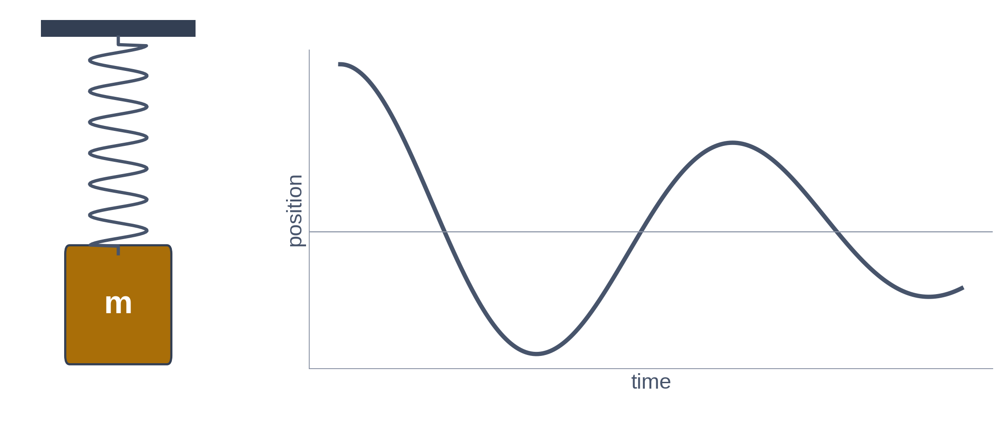

# Exercise 1 · A law is not a pattern

*≈ 20 min · lecture Part 1, slides 7 to 10*

## From the lecture

> **Red box 1:** *A pattern in data is a nudge: usually right, eliminates nothing. A law of
> nature is a constraint: exactly true, everywhere, and it removes whole sets of answers. A
> model told the law can score better with no data at all than a model shown examples.*

## What you are doing

**In one sentence:** you will race a network that is told the law of a swinging spring, and shown
no measurements at all, against the same network shown up to 64 measurements.



## Predict first

- **1a.** One *pattern* and one *law* from your own work or life. What does each do to the list
  of possible answers?
- **1b.** Which ends with the lower error: data-only with 64 measurements, or physics-informed with
  none? By roughly what factor: 2, 20 or 200 times? Why?

## Run

```python
ls.two_kinds_of_advice()
ls.the_race()                     # about 70 seconds
```

## Look at

**Printout A** against your 1a, then **Table B**: the `observations` and `test RMSE` columns.

## Explain

- **1c.** Record the two errors. Was 1b right?
- **1d.** What did each model's loss compare the network's guess *against*? Use that to explain
  why one model needs measurements and the other does not.

## Change one thing *(optional, 3 min)*

- **1e.** Predict first: with 64 *perfect* measurements, no noise, will the data-only model beat
  the physics-informed one? Then run `ls.the_race_without_noise()` and read **Table B2**. If noise
  was not the whole story, where does the data-only model's error come from?
