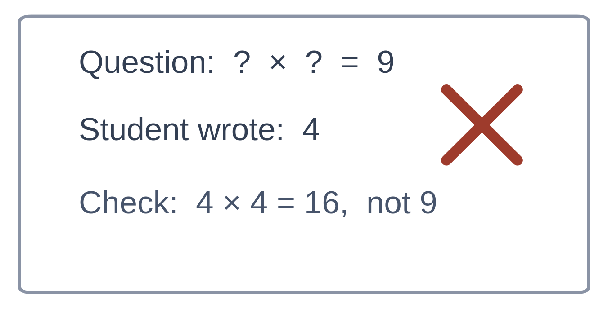
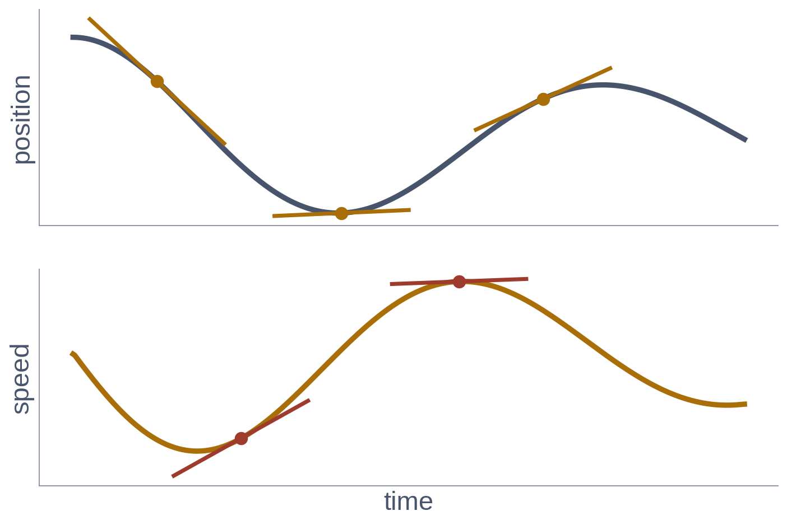

# Exercise 2 · Checking the equation where there is no data

*≈ 35 min · lecture Part 2, slides 13 to 17; the code on slide 18 · **you build two things***

## From the lecture

> **Red box 2:** *A physics-informed network is an ordinary network with an unusual loss: put
> the network's guess back into the equation and square what is left over. Checking an equation
> does not need the answer. The one new tool is taking the derivative of a derivative, exactly.*

## What you are doing

**In one sentence:** you will write the two lines that turn an ordinary network into a
physics-informed one, mark homework with them, and then train a network with them.



## Predict first

- **2a.** Three candidate answers for the spring: the true solution; `cos(t)`, a swing that forgets
  the friction; and a flat line at 0.7. Put back into  m u'' + c u' + k u, which leaves exactly
  zero, and which leaves the most?

## Build 1: the leftover

`u` is the guess, `u_t` its slope, `u_tt` the slope of its slope (at many times at once); `m`,
`c`, `k` are the spring's numbers. Return what is left over when the guess is put back into
**m u'' + c u' + k u = 0**. One line, using only `+`, `-` and `*`.

```python
def my_residual(u, u_t, u_tt, m, c, k):
    return None      # <- replace None with your one line

ls.check_my_residual(my_residual)
```

Run it until every line shows ✓. The check tells you which term to look at if one is wrong; it
never prints the answer. Paste your line into **2b**. Then mark the homework with it:

```python
ls.mark_the_homework(my_residual)
```

**Look at Printout A.** Was 2a right? **2c:** the flat line leaves the same number at every time.
Which number, and why exactly that one? *(Work out u' and u'' for a flat line first.)*



## Build 2: the physics loss

Turn the leftover at 200 times into **one number** that is zero only when the leftover is zero
everywhere. It can be positive at one time and negative at another. You have `mean(...)`.

```python
def my_physics_loss(residual):
    return None      # <- replace None with your one line

ls.check_my_loss(my_physics_loss)
ls.train_with_my_loss(my_residual, my_physics_loss)    # about 20 seconds, no measurements
```

Paste your line into **2d**, and say why the loss cannot be the plain average of the residual.

## Look at

**The plot** and **Table G**: your network, trained on zero measurements, against the true swing.
Compare its test RMSE with the physics-informed row of Exercise 1, Table B.

## Explain

- **2e.** Record both errors. What did your two lines have to get right for them to match?
- **2f.** *Before running `ls.one_thing_changed()`:* which step of Week 3's loop (guess, check,
  blame, nudge) did your code replace, and why does that step need no measurements? Then run it
  and compare with **Table D**.
- **2g** *(optional).* Run `ls.the_engine()` and `ls.why_not_finite_differences()`. Which derivative
  does the finite difference get more wrong, and why does that matter for a loss built on u''?
