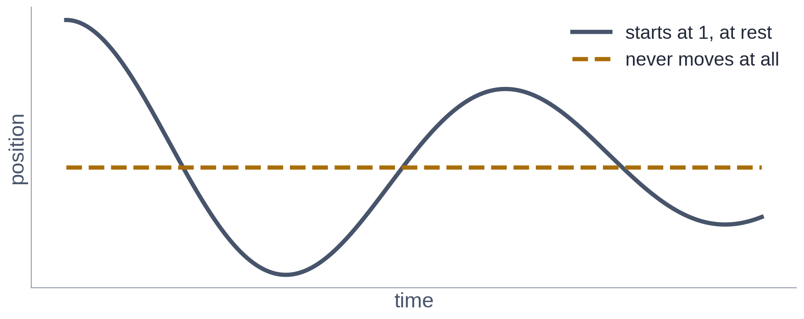

# Exercise 4 · What it costs, and the two ways it goes quietly wrong

*≈ 35 min · lecture Part 4, slides 27 to 34; the code on slide 31 · **you build one thing***

## From the lecture

> **Red box 4:** *A soft penalty needs a weight nobody can derive; a hard constraint builds the
> condition into the arithmetic. A small loss only speaks for the places you checked. A wrong law
> is worse than no law: the loss stays small while the answer goes wrong.*

## What you are doing

**In one sentence:** you will try two ways of building in the starting condition, build the better
one yourself, then find out what a small loss does and does not promise, and what a wrong law does.

## Predict first

- **4a.** The start u(0) = 1 is asked for with a *soft penalty* of weight 1, 50 or 500. Which
  weight gives the lowest error? Will the weight-500 model get u(0) = 1 right?

```python
ls.the_weight_nobody_can_derive() # about 90 seconds
```

**Look at Table A**: the `u(0)` column *and* the error column.
**4b:** how can the weight-500 model get the start right and still be badly wrong?

## Build 3: the hard constraint



`N` is the network's raw output at times `t`. Return a guess built from `N` so that
**u(0) = 1 and u'(0) = 0 for any network at all**, before any training. Use `t`, `N`, numbers and
`+ - * /`. Hints, one at a time: (1) start from `1 + something * N`; (2) the something must be zero
at t = 0; (3) so must its slope.

```python
def my_guess(t, N):
    return None      # <- replace None with your guess

ls.check_my_constraint(my_guess)
ls.train_with_my_constraint(my_guess, my_residual, my_physics_loss)   # about 20 seconds
```

This trains with all three of your functions. Paste every version you trained into **4c**.

**Look at the plot and Table A2**, against the `hard constraint` row of Table A.
**4d:** if yours is close, why does your guess work? If it is much worse, use the printout's clue
to explain why, and (optional) try a second version.

## Predict, run, explain: too few checkpoints

- **4e.** The equation is checked at 10, 50 or 200 places. Which run *reports* the smallest physics
  loss? Which has the smallest *real* error?

```python
ls.too_few_checkpoints()          # about 40 seconds
```

- **4f.** **Table B**, middle column against last: what does a small physics loss actually
  promise, and what does it leave unchecked?

## Change one thing: your own wrong law

The lecture's question 6: *what happens if my law is wrong by 20%?* The true friction is 0.2.

- **4g.** Predict first: told 0.24 (20% too high), or a value you choose, will the physics model
  beat data-only, match it, or lose?

```python
my_wrong_c = 0.24                 # <- the friction you tell the model
ls.when_the_law_is_wrong(c_assumed=(0.2, my_wrong_c, 0.4, 0.8))   # about 90 seconds
```

- **4h.** **Table C**, `true RMSE` then `physics loss it reports`. At c = 0.8, would the loss have
  warned you? Why is a wrong law worse than no law?
