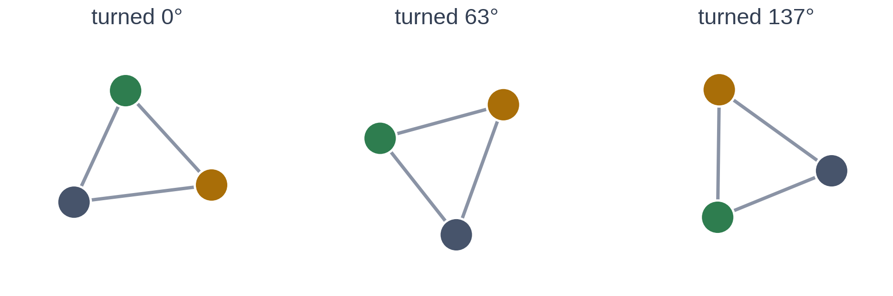

# Exercise 5 · Four more ways to build in science

*≈ 25 min · lecture Part 5, slides 37 to 43; the code on slide 40*

## From the lecture

> **Red box 5:** *Symmetry: feed the model only what cannot change under the symmetry, and it
> cannot get it wrong; but a false symmetry is a wall. A neural ODE learns the rule, not the
> answer. A neural operator learns a whole family at once. Diffusion runs a known process backwards.*

## What you are doing

**In one sentence:** four quick predictions, four runs, then explain each idea in one sentence of
your own.

## Predict, run, look at

| Predict first | Then run | Then read |
|---|---|---|
| **5a.** Rotate the arrangement: whose answer changes, coordinates or distances, and by roughly how much? | `display(ls.spin_it())`, `display(ls.unseen_orientations())` | **5b:** Tables A and B |
| **5c.** Add gravity, so which way up matters. Which model wins? Would more data rescue the other? | `ls.a_false_symmetry()` | **5d:** Table C. Why can the loser never catch up? |
| **5e.** Run three times past the training window: does the model of the *answer* or of the *rule* degrade more? | `display(ls.learn_the_rule())`, `display(ls.a_whole_family())` *(about 40 seconds)* | **5f:** Tables D and E. What does the operator trade for its speed? |
| | `ls.ink_in_water()` | Table F, last column. Nothing was trained. |

## Explain: teach it back

- **5g.** One sentence each, in your own words, for a colleague who missed the lecture: symmetry;
  a neural ODE; a neural operator; diffusion (which half is physics, which half is learned).
