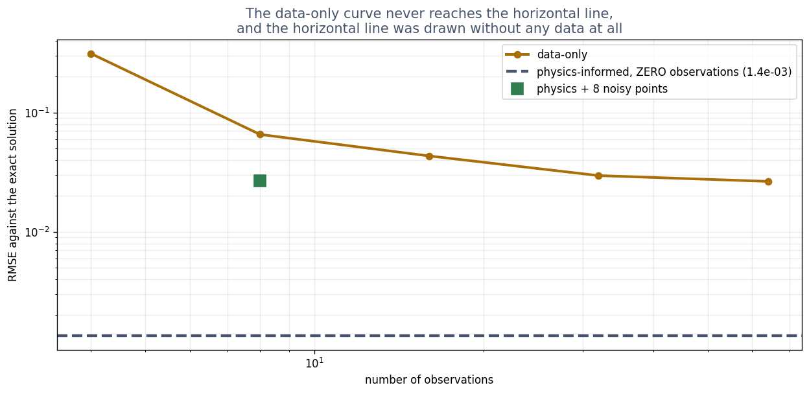

# Exercise 1 · A law is not a pattern

**1a · your pattern and your law.** A good pair: *"cars on this road usually do about 50 km/h"*
(a pattern: it makes 50 likely and 120 unlikely, but rules nothing out) and *"this car cannot be
in two places at once"* or *"the fuel used cannot be negative"* (laws: they remove whole sets of
answers, always). **Test for your own pair:** could a single new observation overturn it? If yes,
it is a pattern.

**1b · prediction.** Physics-informed, by about **20 times**.
*The tempting answer:* data-only, because 64 measurements "must" beat none. The model told the
law is not short of information; it has a different kind: what every answer must satisfy.

**1c · record.** Physics-informed, 0 observations: **0.00135**. Data-only, 64 observations:
**0.02648**. About 20 times better, from no data.

**1d · explain.** The data-only loss compares the guess with **measurements**: how far is it from
the points? With no points it has nothing to compare against. The physics loss compares the guess
with **the equation**: put the guess into m u'' + c u' + k u and see what is left over. That check
works at any time you choose, so it needs no measurements at all. Same network, same optimiser,
same steps: only what the guess was checked against changed.

**1e · change (optional).** Noise-free, data-only reaches **0.0069** with 16 points and **0.0053**
with 64: much better than with noise, and still about **4 times worse** than physics with nothing.
*The tempting answer:* "perfect data closes the gap". It does not, because the data-only model is
only ever told about 64 instants. Between them it is free to do anything that passes through the
points, and it has no idea how the swing *must* behave there. The physics model was checked at 200
places it chose, against a rule true at all of them.
