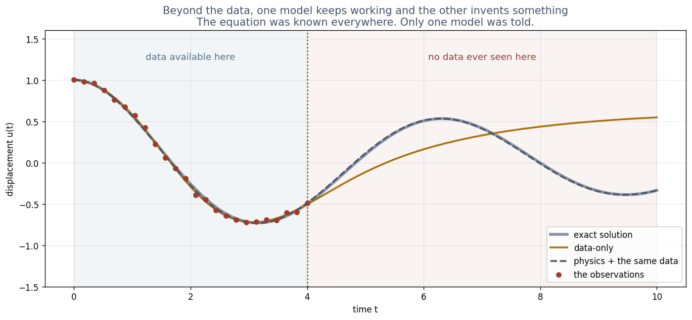
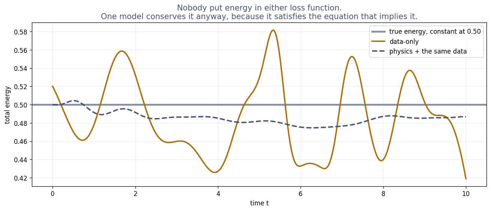

# Exercise 3 · What the law buys

**3a · prediction.** Data-only: about **30**. Physics with the same data: about **1**.
*The tempting answer:* physics degrades "a bit, maybe 3". It does not degrade at all, because
beyond the data it is not extrapolating: it is still being checked against the rule.

**3b · record.** Data-only: **27.6** times worse beyond the data. Physics plus the same data:
**1.0**.

**3c · explain.** The equation was checked at checkpoints across the **whole** run, including the
60% where nobody measured anything. A law is true everywhere, so the model had information there;
the data-only model had none and simply carried on its last trend.

**3d · change (optional).** Data only up to 20%: data-only **63.9**, physics **1.5**. The data-only
factor more than doubles, and its error beyond the data rises from 0.50 to 0.82: less data, more
unknown time, more room to wander. The physics factor moves only from 1.0 to 1.5, and not because it
got worse: its error beyond the data actually *fell*, from 0.0087 to 0.0049. The ratio rose because
it fits the shorter data window even more closely (0.0032). Read a ratio's top and bottom before
reading the ratio.

**3e · prediction.** Most drift to least: **data-only, physics plus data, physics only.**
*The tempting answer:* physics plus data is best "because it has both". The noisy measurements pull
it slightly away from the rule, and the rule is what carries energy conservation.

**3f · record and explain.** Data-only drifts **16.3%**; physics plus data **5.1%**; physics only
**0.2%**. Energy was in nobody's loss. But with no friction, *conservation of energy is a
consequence of the equation*: any curve that satisfies m u'' + k u = 0 everywhere has constant
energy. A model that satisfies the equation inherits that for free, along with every other
consequence of it, whether or not anyone thought to check.
