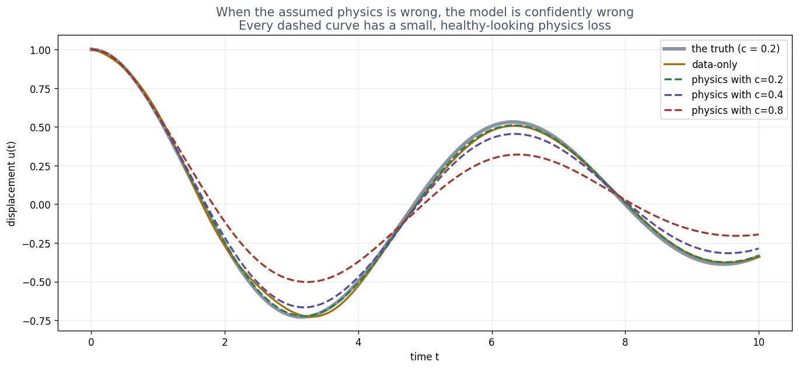

# Exercise 4 · What it costs, and how it goes wrong

**4a · prediction.** Weight **1** gives the lowest error of the three. And **yes**, the weight-500
model gets u(0) = 1 right.
*The tempting answer:* weight 500, "because the start matters most". That is the trap the exercise
is built around.

**4b · explain.** Errors: weight 1 **0.00154**, weight 50 **0.322**, weight 500 **0.664**, hard
constraint **0.00135**. Every soft version has u(0) correct to four decimals. With weight 500, the
loss says the start is 500 times more important than the equation, so the optimiser spends nearly
all its effort on one number it already has right and neglects the equation everywhere else. The
right weight cannot be worked out in advance: you only find it by trying, and here the spread is
over 400 times.

**4c · build.**

```python
def my_guess(t, N):
    return 1 + t * t / (1 + t * t) * N
```

Why it works: call the factor s(t) = t²/(1 + t²). At t = 0, **s = 0**, so u(0) = 1 whatever N is.
The slope of s at 0 is **also 0**, and the slope of s·N is s'·N + s·N', which is 0 + 0 at t = 0,
so u'(0) = 0. Both conditions hold for any weights, before any training.

**4d · record and explain.** Reference: **0.00135**, the same as the hard-constraint row, because it
is the same construction.

Common versions, all of which pass both checks:

| your guess | error | why |
|---|---|---|
| `1 + t*t/(1 + t*t)*N` | **0.00135** | the factor rises from 0 and levels off near 1 |
| `1 + (1 - exp(-t)) * (1 - exp(-t)) * N` (with `from autodiff import exp`) | about 0.008 | also levels off; slightly harder to train |
| `1 + t*t*N` | about **0.29** | the factor reaches **100** at t = 10 |

`1 + t*N` fails the second check: t is zero at the start, but its slope is 1, so the network still
sets the starting speed. **The `t*t*N` lesson:** the conditions are right, but at t = 10 the network
must output values a hundred times smaller than at t = 1 to stay on the swing, and the slopes the
residual needs are multiplied up by the same factor. The training problem becomes badly scaled. A
correct constraint can still be a poor one: it is week 3's input-scaling lesson again, one level up.

**4e · prediction.** **10 checkpoints** reports the smallest loss, and has the **largest** error.
*The tempting answer:* more checkpoints, smaller loss. Fewer places to satisfy is easier, so the
loss gets smaller, and says nothing about everywhere else.

**4f · explain.** Loss at 10 checkpoints **2.6e-06**, error **0.298**; at 50, **4.9e-05** and
**0.0015**; at 200, **8.7e-05** and **0.0035**. A small physics loss promises one thing: the
equation is nearly satisfied **at the places you checked**. Between them, the network can do
anything. Checkpoints must be dense enough to cover the whole problem; the loss cannot tell you
whether they are.



**4g · change.** Told **0.24** (20% too high): **0.0195**, against **0.0215** for data-only and
**0.0142** for the correct law. Still slightly better than no law, but about three quarters of the
advantage is gone. At 0.4 (2x) it is already worse: **0.0499**.
*The tempting answer:* "20% off is close enough to keep most of the benefit". The benefit came from
the law being *exact*; an approximately right law buys approximately nothing.

**4h · explain.** At c = 0.8 the physics model is **0.1455**, about **7 times worse** than data-only,
and its physics loss is still small (**2.3e-02**). **No, the loss would not have warned you.** It
measures agreement with the law you supplied, and the model agrees with it very well: it is
consistently and confidently wrong. A wrong law is worse than no law because it actively pulls the
model away from the data, and the one number you would watch says everything is fine.
