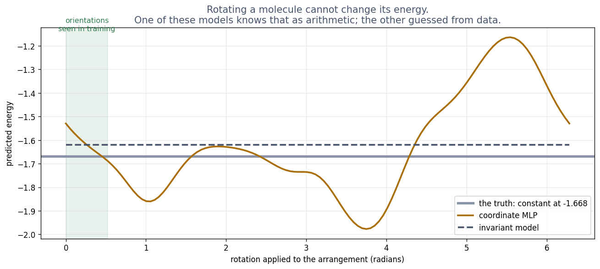

# Exercise 5 · Four more ways to build in science

**5a · prediction.** The coordinate model's answer changes, by a few per cent; the distance model's
does not change at all.
*The tempting answer:* "both change a little". The distance model cannot change: rotating the
arrangement does not change one distance, and distances are all it sees.

**5b · record.** Rotation changes the coordinate model by **6.4%** and the distance model by
**8.88e-16** (rounding error: zero). On orientations never seen in training, the coordinate model
degrades **6.2** times; the distance model **1.0**.

**5c · prediction.** With gravity, the **coordinate model** wins, and **no**, more data cannot
rescue the distance model.
*The tempting answer:* "the symmetric model just needs more data". It has no input that could
ever tell it which way is up.

**5d · explain.** Coordinate model **0.11**, distance model **0.24**. With gravity, turning the
arrangement upside down changes the energy, but the distance model was built so that it *cannot
see* the turn. No amount of data fixes a model that has been made blind to the thing that matters.
A true symmetry is a free guarantee; a false one is a wall.

**5e · prediction.** The model of the **answer** degrades more.
*Why:* it learned "at this time, this position", which says nothing about times it never saw. The
model of the rule learned "from here, things change like this", which applies at any time.

**5f · record and explain.** Degradation three times past the window: answer **11.6**, rule **1.7**,
structured rule **1.6**. **The operator** answers a new friction value in **0.27 ms** against about
**10 s** for a fresh PINN. What it trades: one up-front training on solved examples, answers that
are only good *inside the family it was trained on*, and accuracy against a properly trained
solver: about 60 times worse in the lecture's full run. Careful with this lab's quick run: there
the operator looks slightly *more* accurate (0.055 against 0.066), because each fresh PINN is only
trained briefly. That is a reason to check how a comparison was set up before trusting its winner.

**5g · teach it back.** For comparison, one reference sentence each:

- **Symmetry:** give the model only what cannot change under the symmetry (here, distances), and it
  cannot get the symmetry wrong; give it a false symmetry, and it cannot get the answer right.
- **Neural ODE:** learn how the state *changes* from moment to moment, then step forward, so it works
  from any start and keeps working past its training window.
- **Neural operator:** learn the whole family of problems at once (here, every friction value), so a
  new member costs a fraction of a millisecond instead of a new training.
- **Diffusion:** the forward half, adding noise until the data dissolves (Table F: 0.003 from pure
  noise after 200 steps), is given by physics and learns nothing; only the reverse half, undoing
  one small step of noise, is learned.
