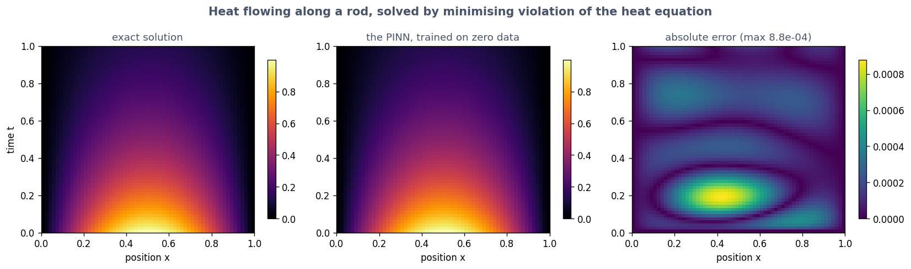

# Exercise 6 · Choosing

**6a · prediction.** Physics with **0** measurements wins, by about **40 times**.
*The tempting answer:* "two inputs is harder, so the physics advantage shrinks". Here it grows: a
rule checks a whole surface of position and time, while 128 measurements are scattered points on it.

**6b · record.** Physics-informed, 0 observations: **0.00043**. Data-only, 128: **0.0180** (and 8
measurements: 0.172).

**6c · match.** 1 **C** · 2 **G** · 3 **E** · 4 **A** · 5 **F** · 6 **D** · 7 **B**.

| if you have | reach for | because |
|---|---|---|
| an equation, one situation to solve | a physics-informed network (PINN) | needs no data; gives the answer and its slopes |
| an equation, thousands of situations | a neural operator | train once, then each new case costs a fraction of a millisecond |
| an equation on a standard, simple domain | a classical numerical solver | faster, more accurate, with error guarantees |
| an equation with a number you do not know | a PINN, run backwards | make the unknown number a trainable dial |
| half the rule known, half unknown | a structured neural ODE | impose the known half, learn the rest |
| an exact symmetry | an invariant or equivariant model | an exact guarantee and far less data needed |
| no reliable physics at all | ordinary machine learning | a guessed law is worse than none |

The two most often missed: **3** (people reach for a PINN; a classical solver is simply better on a
standard problem) and **4** (a PINN run backwards: the unknown number becomes something it learns).

**6d · apply.** There is no single answer; what matters is that question 2 and question 6 are
answered honestly. An example from outside physics: *a warehouse's stock count.*
Q1: stock tomorrow = stock today + deliveries − sales. Q2: exactly true, *if* every movement is
recorded; roughly true once breakage and theft exist. Q6: a 20% gap between recorded and real
movements would make a model that enforces the rule confidently wrong, the 4h failure. Q7: for
counting, ordinary arithmetic beats any model; a learned model earns its place only for
forecasting sales, where no law exists.
