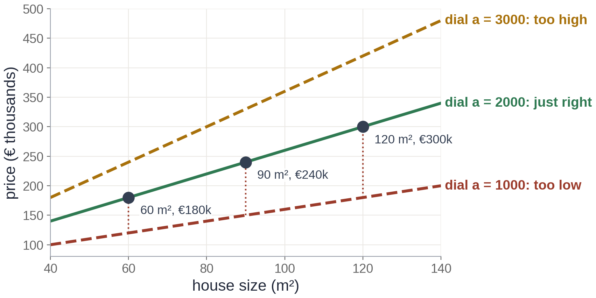

# Exercise 1 · A formula with dials

*≈ 15 min · lecture Part 1, slides 5 to 8*

## From the lecture

> **Key idea:** *A model is a formula with dials. The loss is one number for how wrong a setting of
> the dials is. Learning means finding the setting with the lowest loss.*

> **The formula:** ŷ = a·x + b
>
> **In words:** price = a × size + base price
>
> **With numbers:** €240,000 = 2,000 × 90 m² + €60,000

## What you are doing

**In one sentence:** you will try three settings of one dial on three houses, score each setting
with one number, and see which one wins.



## Predict first

- **1a.** Three houses: 60 m² sold for €180k, 90 m² for €240k, 120 m² for €300k. With the base price
  at €60k, which of a = 1000, 2000 or 3000 gives the smallest loss? Is the loss for the other two
  closer to 90, 900 or 9,000?

## Run

```python
ls.three_dials()
```

## Look at

**Printout A**: the `misses` and `loss` columns, and the last line.

## Explain

- **1b.** Record the three losses. Was 1a right?
- **1c.** Why are the losses for a = 1000 and a = 3000 exactly the same?
- **1e.** Sort these into *parameters* (the computer learns them) and *hyperparameters* (you choose
  them): a, b, the step size, the number of hidden layers, a neuron's weights, the number of epochs.

## Change one thing *(optional, 3 min)*

- **1d.** Predict first: if the base price drops to €40k, is a = 2000 still the best setting? Then run
  `ls.three_dials(b=40)` and read **Printout A2**. What does this tell you about the two dials?
