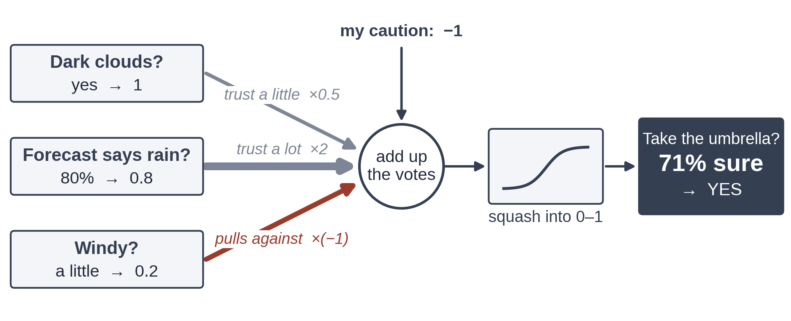

# Exercise 2 · One neuron

*≈ 20 min · lecture Part 2, slides 9 to 15*

## From the lecture

> **Key idea:** *A neuron multiplies each input by a weight, adds them up with a bias, and bends the
> total. With the S-curve as its bend it is Week 2's logistic regression, and it can only ever draw
> one straight line.*

> **The formula:** z = w₁x₁ + w₂x₂ + w₃x₃ + b, then ŷ = σ(z)
>
> **In words:** score = trust × clouds + trust × forecast + trust × wind + caution; how sure = squash(score)
>
> **With numbers:** 0.9 = 0.5 × 1 + 2 × 0.8 + (−1) × 0.2 + (−1); 0.71 = squash(0.9)

## What you are doing

**In one sentence:** you will run the umbrella and loan neurons from the lecture, then put one
neuron on the two moons and see what a single straight line can and cannot do.



## Predict first

- **2a.** Work out the umbrella's score by hand. Will "how sure" be below 50%, about 70%, or above 90%?
- **2e.** One neuron on the two moons: about 60%, about 85% or about 99% of the new dots right?

## Run

```python
ls.umbrella()
ls.loan()
ls.one_line()
```

## Look at

**Printout A** (the votes and the score), **Printout B** (the `vote` column), then **Table C** and
its picture.

## Explain

- **2b.** Record the umbrella's score and "how sure". Was 2a right?
- **2d.** Which loan clue argues *against* default, and how can you tell from the numbers alone?
- **2f.** Record the score on new dots. Where on the picture are the mistakes, and why can no setting
  of the weights fix them?

## Change one thing

- **2c.** Predict first: with a caution of −3, does the neuron still say "take it"? Then run
  `ls.umbrella(caution=-3)` and read **Printout A2**.
