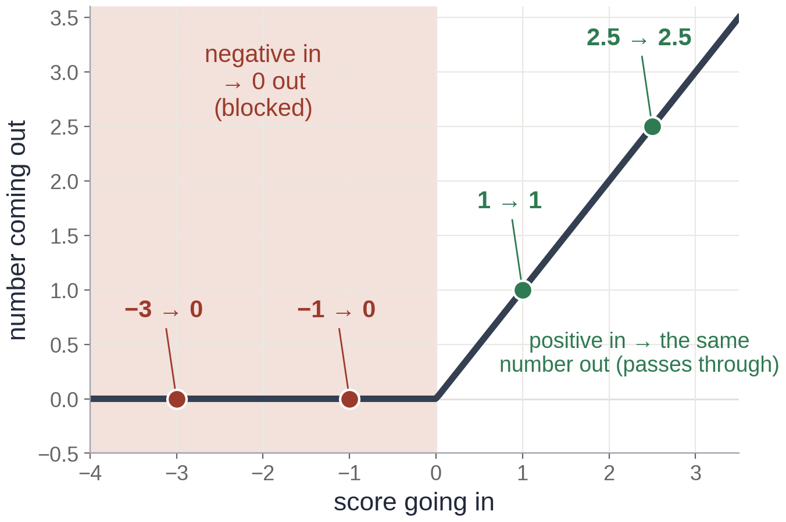
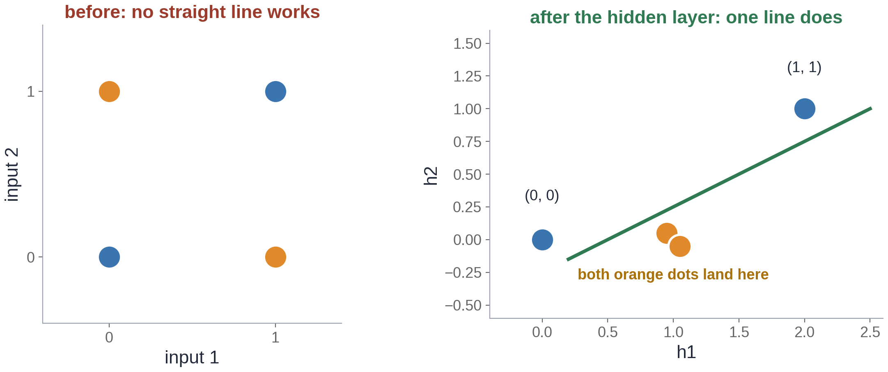

# Exercise 3 · How it is wired

*≈ 25 min · lecture Part 3, slides 16 to 26 · you build a layer*

## From the lecture

> **Key idea:** *One neuron cannot sort the four XOR dots. A hidden layer moves the dots so that a
> straight line works. Every neuron needs a bend: without one, any number of layers collapses into
> one straight line.*

> **The formula:** ReLU(z) = max(0, z)
>
> **In words:** output = the score if it is positive, otherwise 0
>
> **With numbers:** ReLU(−3) = 0, ReLU(0.5) = 0.5, ReLU(2) = 2

## What you are doing

**In one sentence:** you will write a layer of neurons yourself, use it to solve XOR with two hidden
neurons, then take the bend away and watch it break.



## Predict first

- **3a.** ReLU(−3), ReLU(0.5) and ReLU(2)?
- **3d.** With the bend taken out, which of the four XOR dots, if any, will get the wrong answer?

## Run

```python
ls.relu_examples()
```

## Build: a layer

A layer is every neuron's weighted sum of the *same* inputs, then the bend: **h = ReLU(X W + b)**.
`X @ W` multiplies the table of dots by the table of weights, `+ b` adds each neuron's caution, and
`np.maximum(0, ...)` is ReLU. Replace `None` with your one line, run the check until every line
shows ✓, and paste the line into **3b**.

```python
def my_layer(X, W, b):
    """Every neuron's weighted sum of the same inputs, then the ReLU bend."""
    return None      # <- replace None with your one line

ls.check_my_layer(my_layer)
```

Then run XOR through your layer, the same wiring without the bend, and the dial count:

```python
ls.xor_by_hand(my_layer)
ls.xor_without_the_bend()
ls.count_the_dials()
```



## Look at

**Printout B** (the `hidden` pairs and the answers), **Printout C** and **Table D**.

## Explain

- **3c.** Record the four answers. Which two dots end up with the same hidden pair, and why does that
  let one straight line separate orange from blue?
- **3e.** Was 3d right? Use Printout C to say in one sentence why every neuron needs a bend.
- **3f.** Record the total from Table D, and say where each layer's number comes from.
