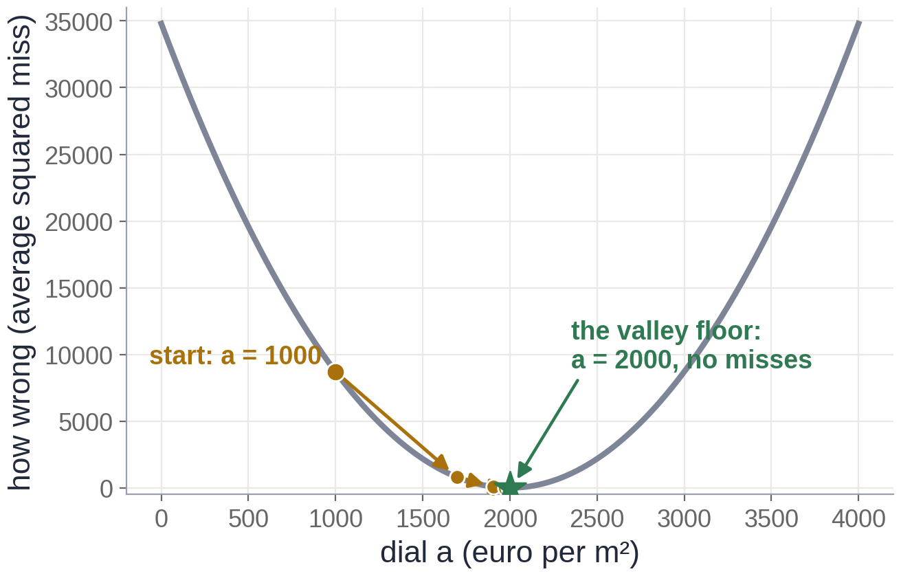

# Exercise 4 · Check and nudge

*≈ 20 min · lecture Parts 4 and 5, slides 27 to 39 · you build the nudge*

## From the lecture

> **Key idea:** *The loss is one number for how wrong. Gradient descent turns each dial a little
> against its slope. The step size decides whether it crawls, settles, bounces or explodes.*

> **The formula:** θ ← θ − η · ∂L/∂θ
>
> **In words:** new dial = old dial − step size × slope
>
> **With numbers:** 1,696 = 1,000 − 40 × (−17.4)

## What you are doing

**In one sentence:** you will see what cross-entropy charges for a confident mistake, write the
formula of the day as one line, and use it to walk the house dial down to 2000 on its own.



## Predict first

- **4a.** For one dot whose right answer is orange, rank the penalties: 90% sure, 50/50, 5% sure. Is
  the biggest about 2 times or about 30 times the smallest?
- **4d.** Starting at a = 1000 with step size 40, where will a be after five steps: about 1300, about
  1700, or very close to 2000?
- **4f.** For step sizes 5, 40, 100, 120 and 130, which will crawl, settle, bounce or explode?

## Run

```python
ls.penalties()
```

## Build: the nudge

Write the formula of the day as one line, run the check, and paste the line into **4c**.

```python
def my_nudge(dial, slope, step):
    """new dial = old dial − step size × slope"""
    return None      # <- replace None with your one line

ls.check_my_nudge(my_nudge)
```

Then walk downhill with it, and try five step sizes:

```python
ls.walk_downhill(my_nudge)
ls.step_sizes(my_nudge)
```

## Look at

**Printout A**, then **Table B** (the `a` column) and **Table C**.

## Explain

- **4b.** Record the three penalties. Was 4a right?
- **4e.** Record a after five steps. At step 0 the slope is negative: why does that make the dial go *up*?
- **4g.** Record Table C. Between which two step sizes does this valley switch from settling to exploding?
