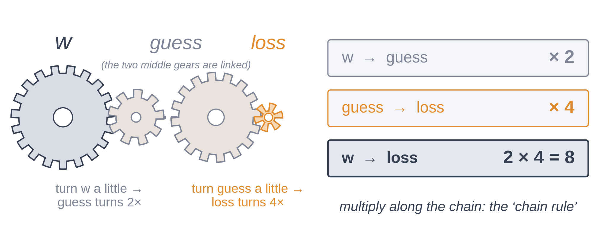

# Exercise 5 · Blame

*≈ 25 min · lecture Part 6, slides 40 to 50 · you build backpropagation*

## From the lecture

> **Key idea:** *A dial's blame is how much the loss moves when you nudge it. Backpropagation finds
> every dial's blame in one walk backwards, multiplying along the chain. Nudging is too slow to
> train with, but it is the perfect referee.*

> **The formula:** ∂L/∂w = ∂L/∂ŷ · ∂ŷ/∂w
>
> **In words:** (how much w moves the loss) = (how much the guess moves the loss) × (how much w moves the guess)
>
> **With numbers:** 8 = 4 × 2

## What you are doing

**In one sentence:** you will find one dial's blame two ways, write the three rules of
backpropagation, and prove them right against nudging for all 337 dials of the lecture's network.



## Predict first

- **5a.** One dial: w = 3, x = 2, b = 1, truth = 5. Is w's blame positive or negative, and nearer 2,
  8 or 20?
- **5e.** If rule 3 forgot that switched-off neurons pass no blame, would the check still pass? Would
  the difference be about 1e-6, about 1e-3, or about 0.5?

## Run

```python
ls.one_dial()
```

## Build: backpropagation

Fill in the three rules, one line each:

| Rule | In words | In code |
|---|---|---|
| 1 | blame at the end = guess − truth (averaged over the dots) | uses `h[-1]`, `y`, `len(y)` |
| 2 | a weight's blame = what came in × blame going out | uses `h[i]` and `delta` |
| 3 | hand the blame back through the same weights, and nothing through a switched-off neuron | uses `W[i]` and `z[i - 1] > 0` |

`h` is every layer's numbers from the forward pass (`h[0]` is the input, `h[-1]` the guesses), `z`
every layer's scores, `W` every weight table. Paste your three lines into **5d** when every line of
the check shows ✓.

```python
def my_backward(h, z, W, y):
    """The three rules of backpropagation."""
    gW, gb = [None] * len(W), [None] * len(W)
    delta = None                                   # rule 1
    for i in reversed(range(len(W))):
        gW[i] = None                               # rule 2
        gb[i] = delta.sum(0, keepdims=True)        # a bias's blame: the blame, added up over the dots
        if i > 0:
            delta = None                           # rule 3
    return gW, gb

ls.check_my_backward(my_backward)
```

Then the same check with rule 3's switch removed:

```python
ls.backward_without_the_switch()
```

## Look at

**Printout A**, the check's **Printout B** line, and **Printout C**.

## Explain

- **5b.** Record both blames from Printout A. Why is the nudging one slightly bigger?
- **5f.** Record the difference in Printout C. What does it tell you about how a gradient check
  catches mistakes?

## Change one thing

- **5c.** Predict first: with truth = 9, what is w's blame, and which way should w turn? Then run
  `ls.one_dial(truth=9)` and read **Printout A2**.
