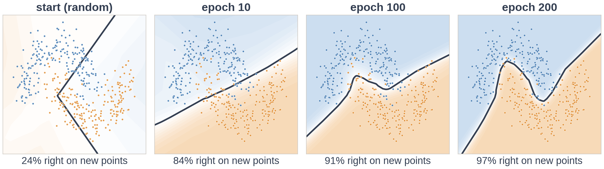

# Exercise 6 · The loop, running

*≈ 20 min · lecture Part 7, slides 51 to 58*

## From the lecture

> **Key idea:** *Training is the four-step loop, batch after batch, epoch after epoch: guess, check,
> blame, nudge. Always read the practice and test results together.*

## What you are doing

**In one sentence:** your backpropagation goes inside the training loop, first on the two moons, then
on the Week 1 credit data, against Week 2's logistic regression.



## Predict first

- **6a.** On the two moons after 200 epochs, what share of the new dots will it get right? Will it
  beat the straight line from Exercise 2?
- **6d.** On the credit data, will the network beat logistic regression by a lot (5 points or more)
  or a little (under 1 point)?

## Run

```python
ls.train_moons(my_backward)        # about 10 seconds
ls.train_credit(my_backward)       # about 20 seconds
```

## Look at

**Table A** and its picture, then **Table B**.

## Explain

- **6b.** Record the five rows of Table A. Was 6a right?
- **6c.** Between epoch 10 and epoch 50 the score barely moves. What would you have concluded if you
  had stopped at epoch 50?
- **6e.** Record the three accuracies and the share of defaulters caught from Table B.
- **6f.** Why does a curved boundary help so much on the moons and so little here? And what would you
  change, from Week 2, to catch more defaulters?

## Change one thing *(optional, 3 min)*

- **6g.** Predict first, then run `ls.train_credit(my_backward, step=2.0)` and read **Table B2**. The
  accuracy goes *up*: what happens to the test loss, and why should you never judge a run on
  accuracy alone?

## Two last questions

- **L1.** Name the four steps of the loop, in order, and the line of *your* code that does each one.
- **L2.** Which prediction today was furthest off, and what do you think now?
