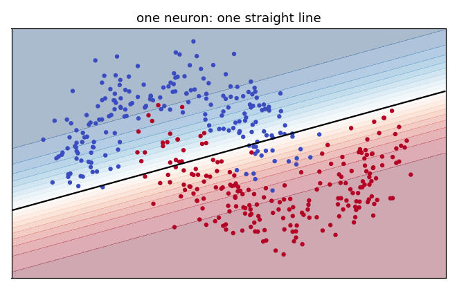

# Exercise 2 · One neuron

**2a · prediction.** Score **0.9**, so about **70%**.
*The tempting answer:* above 90%, because the forecast's vote (1.6) is so big. The wind's −0.2 and the
caution's −1 pull the score back to 0.9, and the squash turns 0.9 into only 71%.

**2b · record.** Score **0.90**; how sure **71%**: take the umbrella.

**2c · change.** With a caution of −3 the score is **−1.10** and the neuron is **25%** sure: leave the
umbrella at home. The bias slides the decision without changing how much any clue counts.

**2d · explain.** **Years in the same job**. Its weight is negative (−0.3), so its vote is negative
(−1.80): the longer someone has held a steady job, the lower the score. A negative weight always
means "this clue argues against".

**2e · prediction.** About **85%**.
*The tempting answer:* 99%, because to the eye the moons look easy to separate. They are easy for a
curve, not for a line.

**2f · record and explain.** **0.861** right on new dots (0.890 on the practice dots). The mistakes
sit at the tips, where each crescent curls into the other. One neuron's boundary is always a straight
line, and no straight line can follow a curl, whatever the weights.

