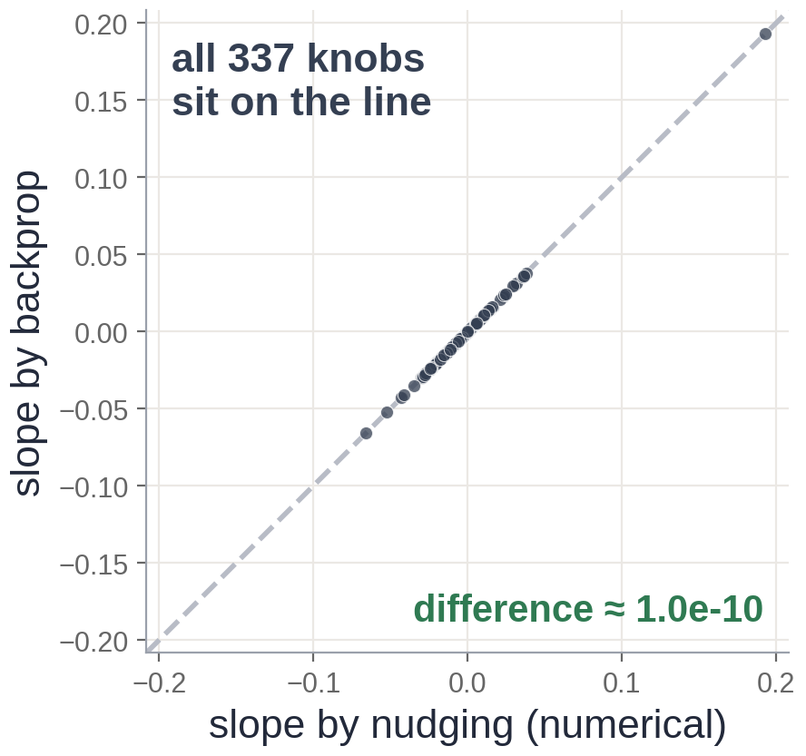

# Exercise 5 · Blame

**5a · prediction.** **Positive**, about **8**.
*The tempting answer:* negative, because the guess is too high. The *blame* is positive (raising w
makes the loss worse); the *action* is to turn w down. The sign of the blame and the direction to
turn are opposites.

**5b · record and explain.** **8.004** by nudging, **8.000** by the chain rule. The nudge is small
but not infinitely small, and the loss curves upwards (it is a square), so the measured slope picks
up a tiny extra 0.004. As the nudge shrinks, the two agree exactly.

**5c · change.** With truth = 9 the miss is −2, so the blame is **−8** (−7.996 by nudging): turn w
**up**.

**5d · build.** The three rules:

```python
delta = (h[-1] - y) / len(y)                    # rule 1
gW[i] = h[i].T @ delta                          # rule 2
delta = (delta @ W[i].T) * (z[i - 1] > 0)       # rule 3
```

The check reports a relative difference of about **6e-11** against nudging, for all 337 dials.



**5e · prediction.** About **0.5**: the check fails badly.
*The tempting answer:* about 1e-6, "a small detail". Skipping the switch hands blame to neurons that
said nothing on the way forward, which corrupts every blame further back.

**5f · record and explain.** **5.4e-01**. A correct backward pass agrees with nudging to about
1e-10; a wrong one is off by many orders of magnitude, not by a little. That is what makes a
gradient check such a good referee: a bug cannot hide in it.
