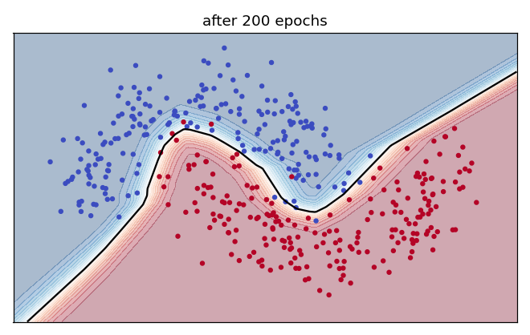

# Exercise 6 · The loop, running

**6a · prediction.** About **97%**: yes, it beats the straight line's 86%.

**6b · record.** Right on new dots at epochs 0, 10, 50, 100 and 200: **24%, 84%, 86%, 91%, 97%**
(loss 0.773 → 0.066).

**6c · explain.** At epoch 50 the network was no better than one straight line (86%), and you might
have concluded that the extra layers bought nothing. Training often sits on a flat stretch before it
finds the bend; the plateau is temporary.

**6d · prediction.** **A little.**
*The tempting answer:* a lot, because the same network won easily on the moons. How much a curve
helps depends on the data, not on the network.

**6e · record.** Everyone "no default": **0.779**. Logistic regression: **0.811**. Network at
epoch 20: **0.817**. Defaulters caught: **31.8%**.

**6f · explain.** The moons need a curved boundary, so bends help a lot. On the credit data most of
the signal is close to a straight line (mostly payment history) and the labels are noisy, so extra
flexibility adds little. To catch more defaulters, lower the cut-off, as in Week 2: at 0.2 the
network catches **61.5%** of defaulters, but only **43.8%** of its flags are right.

**6g · change (optional).** With step size 2.0, accuracy rises to **0.819** but the test loss rises
to **0.503** (from 0.445): the network is right a little more often but much more confidently wrong
when it misses. Accuracy only counts which side of 0.5 a guess falls; the loss also counts how
confident it was.

**L1.** Guess: the forward pass, built from layers like `my_layer`. Check: the cross-entropy loss.
Blame: `my_backward`. Nudge: `my_nudge`'s formula, dial − step × slope, applied to every dial.

**L2.** Your own answer. The most common: 1a, 4a, 4d or 6d.
